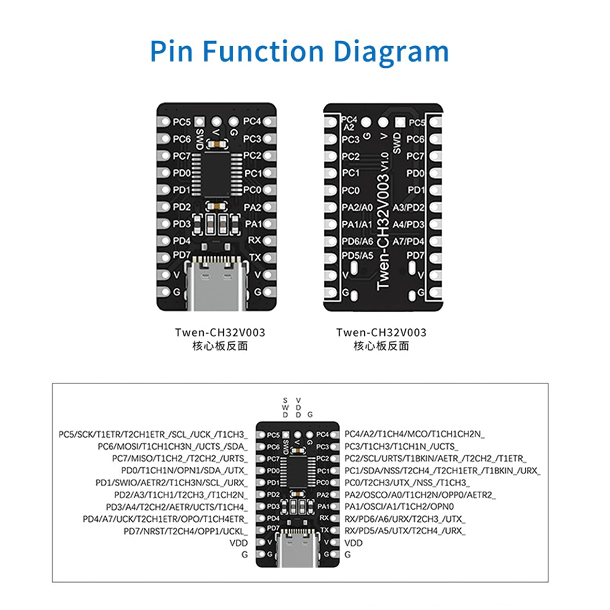

# Programming a CH32V003F4P6 from Linux with an old WCH-Link (CH549)

**Complete technical report — findings, procedure and final state**

> 🌐 **Language:** English · **[Leer este documento en español →](README_ES.md)**



| | |
|---|---|
| **Date** | 19 October 2026 |
| **System** | Linux Mint 22.3 (x86_64), kernel 6.14.0-37 |
| **Target board** | CH32V003F4P6 "core board" (AliExpress 1005008860345338) |
| **Programmer** | Old WCH-Link with a **CH549** MCU (AliExpress 1005010743352061) |
| **Result** | ✅ Program compiled, flashed and running |
| **Extra cost** | €0 (just a 1 kΩ resistor and a jumper) |

---

## Credits and attribution

**This work would not have been possible without [`ch549-link`](https://github.com/e-labInnovations/ch549-link)**
([e-labInnovations](https://github.com/e-labInnovations), MIT license).

That project is the one that discovered and demonstrated that the CH549 **can**
program the CH32V003, wrote the SWIO firmware, documented the bootloader's ISP
protocol and published the web flasher. All the technical credit for the solution
is theirs.

| Contribution | Author |
|---|---|
| SWIO firmware for the CH549 (`swio.bin`), protocol and documentation | **ch549-link** (MIT) |
| `minichlink` tool and ardulink protocol | [ch32v003fun](https://github.com/cnlohr/ch32v003fun) (MIT) / [arduino-ch32v003-swio](https://gitlab.com/BlueSyncLine/arduino-ch32v003-swio) |
| CH55x bootloader flasher | [isp55e0](https://github.com/frank-zago/isp55e0) (GPL-3.0) |
| Platform and Arduino core | [platform-ch32v](https://github.com/Community-PIO-CH32V/platform-ch32v) / [arduino_core_ch32](https://github.com/openwch/arduino_core_ch32) |
| **This report**: verification on real hardware, reproducible procedure, PlatformIO integration (`flash.sh`) and diagnostic notes | Derived documentation — **MIT license** (see [`LICENSE`](LICENSE)) |

> If you reuse or publish this report, **keep the link to `ch549-link`**. The
> hard part was done by them.

## License

This report is published under the **[MIT license](LICENSE)**.

You may use, copy, modify and redistribute it (even commercially) as long as
you keep the copyright notice and **keep the link to
[`ch549-link`](https://github.com/e-labInnovations/ch549-link)**, whose work is
the technical foundation of all of this.

```
MIT License
Copyright (c) 2026 carlymx
```

> ℹ️ **Note:** the full, legal text is in [`LICENSE`](LICENSE). This
> report *documents* the use of third-party tools with their own licenses
> (`ch549-link` and `minichlink` are MIT; `isp55e0` is GPL-3.0); the MIT license
> above covers **this document and the project's own scripts**.

### Licenses of the tools bundled here (`tools/`)

This repository **bundles copies** of third-party tools inside `tools/`. They are
**not mine**: they keep their own licence, copyright notice and, where present,
their own `LICENSE` file in their folder.

| Tool | Location | Author | License | Original source |
|---|---|---|---|---|
| `ch32v003fun` / `minichlink` | `tools/ch32v003fun/` | [CNLohr](https://github.com/cnlohr) | MIT | <https://github.com/cnlohr/ch32v003fun> |
| `isp55e0` (binary) | `tools/wch-link-ch549/isp55e0` | [frank-zago](https://github.com/frank-zago) | **GPL-3.0** | <https://github.com/frank-zago/isp55e0> |
| `wlink-iap` | `tools/wlink-iap/` | [cjacker](https://github.com/cjacker) | MIT | <https://github.com/cjacker/wlink-iap> |
| `ch549-link` (copy) | `tools/wch-link-ch549/ch549-link/` | [e-labInnovations](https://github.com/e-labInnovations) | MIT | <https://github.com/e-labInnovations/ch549-link> |
| WCH-Link firmwares (`swio.bin`, `wch-riscv.bin`, `wch-arm.bin`) | `tools/wch-link-ch549/firmware/` | WCH / ch549-link | per their origin | — |

> ⚖️ **About `isp55e0` (GPL-3.0):** it is bundled pre-compiled for convenience, but
> its **complete source code** is at the link in the table and anyone can fetch and
> rebuild it from there. If you redistribute this repository, **keep this table and
> the links**.
>
> 🏷️ **Trademarks and firmware:** the names *WCH*, *WCH-Link* and the programmer
> firmwares belong to **WCH (Nanjing Qinheng Microelectronics)**. This report only
> documents their use and redistributes copies that were legitimately obtained.

---


## Contents

0. [Credits and attribution](#credits-and-attribution)
   - [License](#license)
   - [Licenses of the tools bundled here](#licenses-of-the-tools-bundled-here-tools)
1. [Executive summary](#1-executive-summary)
2. [The problem](#2-the-problem)
3. [Diagnosis: how we identified the programmer](#3-diagnosis-how-we-identified-the-programmer)
4. [The solution: reflashing the CH549](#4-the-solution-reflashing-the-ch549)
5. [Hardware: required modifications](#5-hardware-required-modifications)
6. [Step-by-step procedure](#6-step-by-step-procedure)
7. [Verification and result](#7-verification-and-result)
8. [Daily use: building and flashing](#8-daily-use-building-and-flashing)
9. [Board pin reference](#9-board-pin-reference)
10. [Guide for AI agents](#10-guide-for-ai-agents)
11. [Troubleshooting](#11-troubleshooting)
12. [Rollback and recovery](#12-rollback-and-recovery)
13. [Technical findings and notes](#13-technical-findings-and-notes)
14. [References](#14-references)
15. [File inventory](#15-file-inventory)

### What's new in the 19/10/2026 revision

- **[§9.3](#93-board-leds) / [§9.4](#94-board-identification) / [§13.10](#1310-using-pd1-as-gpio-why-pinmode-is-not-enough-and-why-it-is-not-advisable)**
  — **Board red LED confirmed and tested: it is on `PD1`, active-low and
  shared with `SWIO`.** Includes the conflict between the family schematic
  (`PC0`) and WCH's documentation (`PD1`), the **three tests** that resolved it,
  **why the first experiment failed** (reading `PD1` with SDI active) and how to
  **free `PD1` from SDI** (`AFIO->PCFR1` / `GPIO_Remap_SDI_Disable`) and recover the
  board with `minichlink -u`.
- **[§7.1.1](#711-frequency-test)** — Validation with an external LED on `PC0`
  (1 Hz and 5 Hz).
- **[§10.4](#104-recipe-locating-the-pin-of-an-led) / [§15](#15-file-inventory)**
  — The pin scan moves to `extras/escaneo_pines.cpp`; the red LED
  experiment lives in `extras/led_rojo_pd1.cpp`.
- **[§12.4](#124-unbricking-the-ch32v003-unbrick)** — *Unbrick* procedure
  tested on real hardware.

---

## 1. Executive summary

We managed to program a **CH32V003F4P6** from Linux using an **old WCH-Link based on the CH549**, a programmer that WCH officially labels as **not compatible** with that microcontroller.

The key: the **hardware is capable**; what doesn't work is the **factory firmware**. The CH549 implements the **2-wire SDI** debug protocol (SWDIO + SWCLK), but the CH32V003 uses **1-wire SWIO** and has no clock pin. By replacing the programmer's firmware with the one from the [`ch549-link`](https://github.com/e-labInnovations/ch549-link) project, the CH549 becomes a SWIO programmer that speaks the **ardulink** protocol over USB-CDC, and `minichlink` drives it without modifications.

**Real requirements:**

- A **1 kΩ** resistor between `SWDIO` and `3V3` on the programmer (mandatory).
- A **jumper on J1** of the programmer (BOOT mode) only during reflashing.
- 3 wires to the microcontroller: `GND`, `3V3`, `SWDIO`→`SWIO`.
- **No proprietary software**: everything with free tools (`isp55e0`, `minichlink`, PlatformIO).

**Additional findings (details in §9.3, §9.4 and §13.10):**

- The board's **red LED** is **not on `PC0`** as many pinouts say: it is
  on **`PD1`**, it is **active-low** and it **shares a pin with `SWIO`**, the
  programming line (which is why it blinks on its own during flashing). **Confirmed in
  hardware** with three tests: it doesn't respond to `PC0` at 1 Hz; the LED that blinks
  while flashing is on the **microcontroller's** PCB; and the sketch that frees `PD1` from
  SDI **turns the red LED on at will** (§9.3, §13.10).
- For any visual test, **use an external LED on `PC0`** (active-high):
  it works first time and is 100 % safe.
- Also documented: **how to free `PD1` from the debug module** (by disabling
  SDI via `AFIO->PCFR1` / `GPIO_Remap_SDI_Disable`), **why the first attempt
  failed** (reading `GPIOD->INDR` with SDI active always returns `0`) and **how to
  recover the board with `minichlink -u`** if it gets stuck (§12.4, §13.10).

---

## 2. The problem

### 2.1 Initial symptoms

With the factory programmer, any attempt at communication failed:

| Tool | Error |
|---|---|
| `wlink status` | `Error: USB error: Input/Output Error` |
| `minichlink` (ch32v003fun) | `Error sending WCH command (on send): 81 0d 01 ff` |
| `openocd` (WCH fork) | `libusb_bulk_write error: LIBUSB_ERROR_TIMEOUT` + `Error: unknow WCH-LINK` |
| Direct libusb write (EP1 and EP2) | `LIBUSB_ERROR_TIMEOUT`, 0 bytes transferred |
| `wlink-iap -i` | `Found device : Unknown adapter` |

### 2.2 Why it failed

The programmer identified itself correctly over USB:

```
idVendor     0x1a86  (QinHeng Electronics)
idProduct    0x8010  (WCH-Link)
bcdUSB       1.10
bcdDevice    2.01    ← firmware v2.01
iProduct     "WCH-Link"
iSerial      "0001A0000001"
```

But its firmware **did not respond to any command** on any of the manufacturer endpoints. It was not a permissions problem, nor a cable problem, nor the microcontroller: the firmware was too old (v2.01, the "combined ARM+RV" version) and spoke a protocol that no modern tool understands.

### 2.3 The underlying incompatibility

WCH's official manual (*WCH-Link 使用说明*, table "Link 支持芯片型号") is blunt:

| Chip | WCH-Link (CH549) | WCH-LinkE | WCH-DAPLink | WCH-LinkW |
|---|:---:|:---:|:---:|:---:|
| **CH32V003** / CH32V002_004_005_006_007 / CH32X035 / CH32L103 / CH643 / CH32V317 / CH32M007 | ❌ | ✅ | ❌ | ✅ |
| CH32V10x / CH32V20x / CH32V30x | ✅ | ✅ | ❌ | ✅ |
| CH569 / CH573 / CH583 | ✅ | ✅ | ❌ | ❌ |

The technical cause is explained by the `ch549-link` project itself:

> The CH32V003 is debugged via **1-wire SWIO** on `PD1`. **There is no clock pin.** WCH's firmware for the CH549 only implements **2-wire SDI** (`SWDIO` + `SWCLK`), and that is why WCH marks the CH32V003 as unsupported on this hardware.

And they verified it experimentally: in RISC-V mode the factory firmware **accepts** `CHIP_CH32V003` (0x09) and responds `82 0c 01 01`, which looks like a correct acknowledgement. But **it is not**: it returns exactly the same response for any byte, valid or meaningless. The firmware "stamps" the chip type without checking it; afterwards the *attach* fails just the same with both 1-wire and 2-wire parts.

**Diagnosis conclusion:** the hardware is not the problem; the firmware is. And since the CH549's bootloader lives in **ROM**, it is impossible to "brick" it and it can always be reflashed.

---

## 3. Diagnosis: how we identified the programmer

These tests were the ones that led to the diagnosis. They are kept here because they are reusable.

### 3.1 USB descriptor

```bash
lsusb -d 1a86:8010 -v
```

Keys to identifying the model:

| Field | Observed value | Interpretation |
|---|---|---|
| `bcdUSB` | `1.10` | 8051 USB full-speed (the CH32V305 uses `2.00`) |
| `bcdDevice` | `2.01` | firmware v2.01 "combined ARM+RV" (only ever existed for the CH549) |
| `iSerial` | `0001A0000001` | generic serial of the old WCH-Links |
| `bMaxPacketSize0` | `8` | typical of the 8051 |
| Interfaces | 3: vendor (EP1/EP2 64 B), CDC control, CDC data | structure of the old firmware |

### 3.2 Entering the bootloader and asking the chip

With jumper **J1** fitted at power-up, the device switches to `4348:55e0` and responds to WCH's ISP protocol:

```bash
./isp55e0
```

```
Found device CH549
Bootloader version 2.4.0
Unique chip ID XX-XX-XX-XX-XX-XX-XX-XX
Current config-bits    00-00-00-00-20-00-00-00-00-d2-c7-b1
```

**This is the definitive proof:** the programmer's MCU is a **CH549** with bootloader **2.4.0**.

> 🔒 **Privacy note:** the `Unique chip ID` is masked on purpose (it is unique to each
> unit). The `config-bits`, on the other hand, **do not identify the chip**: they are
> its configuration options (boot/protection) plus the *checksum* computed by the
> bootloader itself, and any CH549 with the same configuration reports the same ones.
> The USB descriptor `iSerial` (`0001A0000001`) is not unique either: it is a fixed
> constant in WCH's firmware, identical on every unit.

### 3.3 USB identification table

Useful for knowing what state the programmer is in at any moment:

| VID:PID | State |
|---|---|
| `1a86:8010` | Factory WCH-Link, RISC-V mode (old firmware) |
| `1a86:8011` | Factory WCH-Link, ARM/DAP mode |
| `1a86:8012` | WCH-Link in DAP mode (newer models) |
| `4348:55e0` | **ISP bootloader** (jumper J1 fitted at power-up) |
| `1209:c550` | **ch549-link SWIO firmware** (the one we want) |

### 3.4 Command to ask for the variant (if the firmware responds)

On a WCH-Link that does answer, the command `81 0d 01 01` returns `82 0d 04 <major> <minor> <variant>`:

| Variant | Model |
|---|---|
| `0x01` | CH549 (old WCH-Link) |
| `0x02` | CH32V307 |
| `0x03` | CH32V203 (WCH-LinkS) |
| `0x12` | **WCH-LinkE** (already supports the CH32V003, nothing to do) |

---

## 4. The solution: reflashing the CH549

### 4.1 What `ch549-link` is

[`e-labInnovations/ch549-link`](https://github.com/e-labInnovations/ch549-link) (MIT) replaces the CH549's firmware with a SWIO debugger written in C for SDCC. The result:

- It enumerates as **USB-CDC** (`1209:c550`).
- It speaks the **ardulink** protocol (from [`arduino-ch32v003-swio`](https://gitlab.com/BlueSyncLine/arduino-ch32v003-swio)).
- **Standard** `minichlink` drives it without modifications.
- It uses the CH549's `P1.1` (the `SWDIO` pad) to bit-bang SWIO at 48 MHz.

### 4.2 Why it works when WCH said it wouldn't

The CH549 is an **E8051 at 48 MHz** = 20.8 ns per cycle, **3× finer** than the 16 MHz AVR that already bit-banged SWIO successfully. Speed was never the obstacle: it was just that WCH's firmware didn't implement the 1-wire protocol.

Timings measured on the CH549 (documented by the project):

| | total | low phase | in T (125 ns) |
|---|---|---|---|
| short pulse | 28 cycles (583 ns) | ~10 cycles (208 ns) | 1.7 T |
| long pulse | 70 cycles (1458 ns) | ~50 cycles (1042 ns) | 8.3 T |
| high between bits | — | ~18 cycles (375 ns) | 3 T |

### 4.3 The firmware

| File | Size | SHA-256 | Use |
|---|---|---|---|
| `swio.bin` | 4345 B | `bbfc3b39063336a1c4b6ae0286c573e7b90c294005359338c2e7c1a04c212d23` | **SWIO programmer** |
| `wch-riscv.bin` | 45784 B | `eee8b4709ad5080a84ac2da80fbdbea868a64bb280f2ed80943f005c50463cba` | Restore to factory (RISC-V) |
| `wch-arm.bin` | 27734 B | `3cf143a3b6061e8f6a4ca7ee809fffe007219cad062adca259d245f996662284` | Restore ARM/CMSIS-DAP mode |

Verification of `swio.bin`'s reset vector: first bytes `02 00 b6` = `LJMP 0x00b6` (valid).

---

## 5. Hardware: required modifications

### 5.1 1 kΩ resistor (mandatory)

```
        SWDIO (pad del conector)
             │
            1 kΩ
             │
           +3V3
```

**Without it the programmer is unstable:** garbage chip IDs and failed writes. The project verified this by removing it and putting it back.

- It is soldered **between the `SWDIO` pin and the `3V3` pin** of the programmer's connector.
- **Never** to 5V.
- It is a normal line *pull-up*; leaving it in place permanently is correct.

### 5.2 Jumper J1 (BOOT mode)

WCH's official manual confirms it:

> *"To update the Link into BOOT mode (short connect **J1** in Figure 1 **or** long press BOOT key and then power up the Link)"*

On this board variant, the tactile button of other clones was replaced by connector **J1** (silkscreened just below the main chip). **No button is needed**: a 2-pin jumper is enough.

- The state of J1 is **only read at power-up** (the D+ *pull-up* is sampled at reset).
- You fit it with the USB unplugged, plug it in, and it can then be removed.
- **With J1 fitted and the SWIO firmware already flashed nothing happens**: the SWIO firmware doesn't use that pin.

### 5.3 Voltage selector

Set it to **3V3**, never to 5V. The CH549 handles 3.3 V logic and so does the CH32V003.

### 5.4 Wiring to the CH32V003 (only 3 wires)

| CH32V003F4P6 board | WCH-Link programmer | Note |
|---|---|---|
| `GND` | `GND` | |
| `VCC` | `3V3` | the board is powered from the programmer |
| `SWIO` (PD1) | `SWDIO` | 1-wire line |
| — | `SWCLK` | **DO NOT connect** (the CH32V003 has no clock) |

---

## 6. Step-by-step procedure

> 📁 **Example paths:** throughout this report the repository is assumed to live in
> `~/RiscV`. Adjust it to your own. The `flash.sh` script does **not** depend on it:
> it locates the tools relative to its own location.

### 6.1 Preparing the tools

```bash
# 1) minichlink (supports ardulink)
git clone --depth 1 https://github.com/cnlohr/ch32v003fun
cd ch32v003fun/minichlink

# Build WITHOUT libudev (avoids the libudev-dev package):
gcc -o minichlink minichlink.c pgm-wch-linke.c pgm-wch-isp.c nhc-link042.c \
    ardulink.c serial_dev.c minichgdb.c chips.c ch5xx.c stub_programmers.c \
    -lpthread -lusb-1.0 -O0 -g3 -Wall -Wno-unused-function \
    -DCH32V003 -I. -DMINICHLINK -DVERSION='"local"'

# 2) isp55e0 (CH549 bootloader flasher)
git clone --depth 1 https://github.com/frank-zago/isp55e0
cd isp55e0 && make
```

> **Note about `libudev`:** minichlink's standard `make` fails if `libudev-dev` is not
> present. The command above omits `pgm-esp32s2-ch32xx.c` and
> `pgm-b003fun.c` (the ESP32-S2 and B003Fun programmers, which we don't need) and
> replaces them with `stub_programmers.c` containing two functions that return 0.
> You can also install `libudev-dev` and use `make` directly.

### 6.2 Flashing the SWIO firmware onto the CH549

```bash
# 1) With the USB UNPLUGGED: put the jumper on J1
# 2) Plug in the USB (into a port that works)
# 3) Check that the bootloader shows up:
lsusb | grep 4348:55e0
#    -> Bus 001 Device 043: ID 4348:55e0 WinChipHead

# 4) Confirm that it is a CH549:
cd isp55e0 && ./isp55e0
#    -> Found device CH549
#    -> Bootloader version 2.4.0

# 5) Flash it (erases, writes and verifies):
./isp55e0 -f /ruta/a/swio.bin
#    -> Code flashing successful
#    -> Firmware is good

# 6) Remove jumper J1 and plug the USB back in
```

After reflashing, the device should appear as:

```bash
lsusb | grep 1209:c550
# -> Bus 001 Device 044: ID 1209:c550 Generic CH55xduino
ls -la /dev/ttyACM0
# -> crw-rw----+ 1 root dialout 166, 0 /dev/ttyACM0
```

### 6.3 Verifying that it sees the microcontroller

```bash
MINICHLINK=~/RiscV/tools/ch32v003fun/minichlink/minichlink
$MINICHLINK -C ardulink -c /dev/ttyACM0 -i
```

Expected output:

```
minichlink version - local
Opening serial port /dev/ttyACM0 at 115200 baud.
Ardulink: synced.
Ardulink: target power 1
Detected CH32V003
Flash Storage: 16 kB
Part UUID: XX-XX-XX-XX-XX-XX-XX-XX
Part Type: 00-30-05-10
Read protection: disabled
Interface Setup
USER/RDPR  : 08f7/5aa5
DATA1/DATA0: 00ff/00ff
WRPR1/WRPR0: 00ff/00ff
WRPR3/WRPR2: 00ff/00ff
R32_ESIG_UNIID1: XXXXXXXX
R32_ESIG_UNIID2: XXXXXXXX
R32_ESIG_UNIID3: ffffffff
```

### 6.4 Flashing the program

```bash
$MINICHLINK -C ardulink -c /dev/ttyACM0 \
    -w .pio/build/ch32v003f4p6/firmware.bin flash -b
```

Expected output:

```
Detected CH32V003
Flash Storage: 16 kB
Read protection: disabled
Interface Setup
Writing image

Image written.
```

Or, if the project is configured (see §8): **`pio run -t upload`**.

---

## 7. Verification and result

### 7.1 Real session data

| Item | Value |
|---|---|
| Programmer | CH549, bootloader **2.4.0** |
| CH549 UID | *(omitted on purpose)* |
| Firmware flashed onto the CH549 | `swio.bin`, 4345 B, verified |
| State after reflashing | `1209:c550`, `/dev/ttyACM0` |
| Target chip | CH32V003, **16 kB** flash |
| CH32V003 UID | *(omitted on purpose)* |
| Part Type | `00-30-05-10` |
| **Read protection** | **disabled** (`RDPR 08f7/5aa5`) |
| Project firmware | 6224 B (blink of `PC0`) |
| Flash usage | 6224 / 16384 B (**38.0 %**) |
| RAM usage | 472 / 2048 B (**23.0 %**) |
| Result | `Image written.` + LED blinking |

### 7.1.1 Frequency test

Two rates were tested on an **external yellow LED** connected to `PC0` with a
680 Ω resistor to `GND` (`PC0 ── 680 Ω ── anode LED ── cathode ── GND`):

| `T_ON_MS` / `T_OFF_MS` | Frequency | Result |
|---|---|---|
| 500 / 500 | 1 Hz | ✅ visible |
| 100 / 100 | **5 Hz** | ✅ visible, clearly faster rate |

This confirms that the whole chain (compilation → `flash.sh` → minichlink →
execution) works. **The `PC0` pin responds correctly as a GPIO.**

### 7.2 Verifying the write

The chip was re-read and compared with the compiled binary:

```bash
$MINICHLINK -C ardulink -c /dev/ttyACM0 -r /tmp/leido.bin flash 64
$MINICHLINK -C ardulink -c /dev/ttyACM0 -b     # <- essential: resume
xxd -l 32 /tmp/leido.bin
```

```
00000000: 6f10 a002 0000 0000 380c 0000 3c0c 0000  o.......8...<...
```

Identical to the start of `firmware.bin`. **The flashing is correct.**

> ⚠️ **Important:** reading the flash **stops the CH32V003's CPU** and leaves it in *halt*.
> You must always finish with `minichlink -b` (reboot out of halt) or the program
> will not run. The final `-b` of the flashing command does exactly that.

### 7.3 The note about code protection

There was a suspicion (common with CH32V003s bought on AliExpress) that the chip
might come with **read protection enabled**, which would require a prior
`unprotect`/erase step. **On this unit that was not the case:**

```
Read protection: disabled
USER/RDPR  : 08f7/5aa5
```

If `Read protection: enabled` appears in the future, a full erase solves it:

```bash
$MINICHLINK -C ardulink -c /dev/ttyACM0 -E    # erase the whole chip
```

---

## 8. Daily use: building and flashing

### 8.1 Project configuration

`ch32v003-blink/platformio.ini`:

```ini
[env:ch32v003f4p6]
platform  = ch32v
board     = genericCH32V003F4P6
framework = arduino
board_build.core = openwch
monitor_speed    = 115200

; "custom" + upload_command: PlatformIO llama a nuestro script, que usa
; minichlink con el protocolo ardulink.  No usamos "wlink" porque ese
; protocolo solo lo entiende un WCH-LinkE original, no nuestro CH549.
upload_protocol = custom
upload_command  = ./flash.sh $SOURCE
```

> **Why `custom` and not `wlink`:** the ch32v platform offers the protocols
> `wlink`, `wch-link`, `minichlink` and `isp`. None of them works as-is with this
> programmer:
> - `wlink` speaks the WCH-LinkE protocol → fails.
> - `wch-link` uses WCH's OpenOCD → fails.
> - `minichlink` invokes its own binary **without `-C ardulink`** → `Could not
>   initialize any supported programmers` (verified on hardware).
> - `isp` expects the CH32V003's bootloader, which it doesn't have.
>
> With `custom` we control the exact command and the project is self-contained.

`flash.sh` (included in the project) does:

1. **Locates `minichlink`**: the `MINICHLINK` variable, `<project>/tools/minichlink/`,
   `tools/ch32v003fun/minichlink/` by walking up the tree, the `PATH`… and, if it
   finds none, **it downloads it inside the project itself** into
   `<project>/tools/minichlink/`. It uses no absolute path, so the project is
   **self-contained**: you can copy it to another machine and it still works.
2. Locates the firmware —it accepts the `.elf` PlatformIO passes in `$SOURCE`, or
   looks for `.pio/build/*/firmware.elf`— and converts it to `.bin` if needed.
3. Finds the port by its **USB ID** (`/dev/serial/by-id/usb-Deqing_CH55xduino_CH55x-if00`)
   instead of by number, so it doesn't fail if the `ttyACM` changes.
4. Runs `minichlink -C ardulink -c <port> -w <bin> flash -b`.

Options: `./flash.sh` (flashes the last build), `--preparar` (ensures
`minichlink`), `--info` (chip information), `--simular` (does not flash) and
`--help`. Variables: `MINICHLINK`, `MINICHLINK_URL`, `OBJCOPY`, `PUERTO`,
`SIMULAR=1`.

### 8.2 Commands

```bash
cd ~/RiscV/ch32v003-blink

pio run                  # build
pio run -t upload        # build + flash
pio run -t clean         # clean
pio device monitor       # serial monitor (115200)
```

### 8.3 Using minichlink directly

```bash
M=~/RiscV/tools/ch32v003fun/minichlink/minichlink

$M -C ardulink -c /dev/ttyACM0 -i                    # chip info
$M -C ardulink -c /dev/ttyACM0 -w fw.bin flash -b    # flash
$M -C ardulink -c /dev/ttyACM0 -E                    # erase everything
$M -C ardulink -c /dev/ttyACM0 -b                    # resume after halt
$M -C ardulink -c /dev/ttyACM0 -u                    # unbrick
$M -C ardulink -c /dev/ttyACM0 -r out.bin flash 4096 # read 4 kB of flash
```

---

## 9. Board pin reference

### 9.1 Physical layout

```
        ┌───────────────────────────────┐
        │  [USB-C]        CH32V003F4P6  │
        │                               │
        │  GND  SWIO  NC  VCC   ← pads  │
        │                               │
        │  PD4  PD5  PD6  PD7  PA1  PA2 │
        │  GND  PD0  VIN  PC0           │
        │                               │
        │  PD3  PD2  PD1  PC7  PC6  PC5 │
        │  PC4  PC3  PC2  PC1           │
        └───────────────────────────────┘
```

- `VCC` / `VIN`: power (3.3 V / 5 V).
- `GND`: ground.
- `SWIO`: **PD1**, programming line (don't use as GPIO if you want to reprogram).
- `NC`: not connected.
- **24.000 MHz** crystal onboard; **AMS1117-3.3** regulator.

### 9.2 Arduino pin map (`openwch` core)

| Arduino pin | Port | Analog | Notes |
|---|---|---|---|
| `D0` | `PA1` | A1 | |
| `D1` | `PA2` | A0 | |
| `D2` | `PC0` | | |
| `D3` | `PC1` | | |
| `D4` | `PC2` | | |
| `D5` | `PC3` | | |
| `D6` | `PC4` | A2 | |
| `D7` | `PC5` | | |
| `D8` | `PC6` | | |
| `D9` | `PC7` | | |
| `D10` | `PD0` | | |
| `D11` | `PD1` | | **SWIO + red LED** — see §9.3 |
| `D12` | `PD2` | A3 | |
| `D13` | `PD3` | A4 | |
| `D14` | `PD4` | A7 | |
| `D15` | `PD5` | A5 | Serial **TX** |
| `D16` | `PD6` | A6 | Serial **RX** |
| `D17` | `PD7` | | **NRST** — avoid |

**Core default peripherals:**

| Function | Pins |
|---|---|
| `Serial` (UART1) | TX = `PD5`, RX = `PD6` |
| SPI | SS=`PC4`, MOSI=`PC6`, MISO=`PC7`, SCK=`PC5` |
| I2C | SDA=`PC1`, SCL=`PC2` |
| ADC | A0=`PA2`, A1=`PA1`, A2=`PC4`, A3=`PD2`, A4=`PD3`, A5=`PD5`, A6=`PD6`, A7=`PD4` |
| `LED_BUILTIN` | **not defined** (`PNUM_NOT_DEFINED`) |

**Pins to avoid:**

- `PD1` — **SWIO** (programming) **and the board's red LED**. It cannot be used for
  both at once: if you want the LED you have to disable SDI, and then you
  lose the programmer's access while the sketch runs (see §9.3 and §13.10).
- `PD7` — NRST: chip reset.

### 9.3 Board LEDs

| LED | State | Observed behaviour |
|---|---|---|
| Green | — | Power (always on, **not** a GPIO) |
| Red | **board** | Blinks **during every flashing**; **does not** respond to `PC0` |

Here there is a **conflict between the documentary sources and what was observed** that
is worth recording just as it is, because it is the kind of trap that costs you an afternoon.

#### Source A — family schematic (says `PC0`)

The schematic you find when searching for this board (**wagiminator** design,
rev 1.1, CC-BY-SA license; **not included in this repository**, discarded for not
corresponding to this unit) shows:

```
   +3V3                +3V3                 +3V3
     │                   │                    │
   LED1 (green)        LED2 (red)           R3 10k
     │                   │                    ├─── PD7
   R1 1k               R2 1k                 SW1 (RST)
     │                   │                    │
    GND                 PC0                  GND
```

That is: **green = power** and **red = `PC0`, active-low, with 1 kΩ**.

#### Source B — WCH documentation (says `PD1`)

Zephyr's page for the **official WCH board** states something else:

> *"The board is equipped with one LED, wired to **PD1** and SWIO pins."*
> `LED1 (red) = PD1` — `gpios = <&gpiod 1 GPIO_ACTIVE_LOW>`

#### What was observed on this unit

| Test | Result |
|---|---|
| Firmware blinking `PC0` at **1 Hz** (500 ms on / off) | The red LED **does not** light up |
| External LED on `PC0` (`PC0 ── 680 Ω ── LED ── GND`) | ✅ Works |
| During any flashing with `minichlink` | The red LED **blinks** |

#### Verdict: the LED is on the board, on `PD1`, and it is active-low ✅

Three independent tests; the last one is conclusive:

| # | Test | Result | Conclusion |
|---|---|---|---|
| 1 | Disconnect the 3 wires and power the board from its own USB | Only the yellow LED lights up (`PC0`) | The red LED is **not** controlled by the firmware via `PC0` |
| 2 | Which of the two boards blinks while flashing? | **The microcontroller one** | The LED is **on the CH32V003's PCB** |
| 3 | `extras/led_rojo_pd1.cpp`: free `PD1` from SDI and toggle it slowly | **The red LED turns on and off alternating 1.5 s / 1.5 s** | **It is `PD1` and it is active-low** |

Test 2 was already almost conclusive by elimination: of the 3 wires coming from the
programmer (`VCC`, `GND`, `SWIO`), **only `SWIO` toggles**. If the LED blinks *only*
while flashing and is on the microcontroller's PCB, it has to hang off `SWIO`, that is, `PD1`.

Test 3 closed it completely. The observed sequence matched the program **millimetre by millimetre**:

| What was observed | What the code did | Phase |
|---|---|---|
| Both LEDs off for a few seconds | `PD1=HIGH` (red off) + `PC0=LOW` (yellow off) | 1a · 1.5 s |
| **Both light up** | `PD1=LOW` (**red ON**) + `PC0=HIGH` | 1b · 1.5 s |
| The red goes off, the yellow stays on | `PD1` goes back to `SWIO` (floats high) + `PC0=HIGH` | window · 2 s |
| The yellow goes off and both stay off | cycle restart | 1a · 1.5 s |

The red LED lit **exactly when `PD1` was `LOW`** → **active-low confirmed** on real hardware.

**Conclusion (firm):**

| LED | Port | Polarity | Note |
|---|---|---|---|
| Green | — | — | Power (not a GPIO) |
| Red | **`PD1`** / `D11` | **active-low** (`LOW` = on) | Shares a pin with `SWIO` |

The active-low polarity also fits what was observed: `SWIO` at rest is
*pulled high* (the programmer's 1 kΩ pull-up), and it **only goes low** during
communication → which is why the LED blinks only during flashing.

> ⚠️ **Practical recommendation:** for your tests **use an external LED on `PC0`**
> (`PC0 ── 680 Ω ── anode ── cathode ── GND`). It works, it is active-high, it doesn't depend
> on debugging and it doesn't compromise programming. The `PD1` LED is accessible
> but it costs you debugging while the sketch runs (§13.10).

**And why doesn't `pinMode(PD1, OUTPUT)` light anything?** Because while SDI (the
1-wire debugger) is active, **the debug module physically owns the
pin** and GPIO writes are ignored. Freeing it is possible (§13.10), but it has
a high cost and it is *not* recommended.

### 9.4 Board identification

**Two graphic sources** were consulted and **neither describes exactly** the unit
used here. It is best not to mix them up:

| Source | Board | What it describes |
|---|---|---|
| Family schematic (**not included**; discarded) | **wagiminator** *CH32V003F4P6 Development Board* rev 1.1 (CC-BY-SA, OSHW) | MCU, **AP2112K-3.3** regulator, MicroUSB, 2 LEDs, RST button on `PD7`, H1/H2/H3 headers |
| `CH32V003F4P6_PCB.jpg` (cover image) | **Twen-CH32V003** v1.0 (core board) | Silkscreened pin diagram (different arrangement) |

**Useful data from the schematic (valid if your clone respects it):**

| Element | Detail |
|---|---|
| Regulator | `AP2112K-3.3TRG1` (not AMS1117) |
| Crystal | **none**: the chip uses the internal `HSI` |
| Decoupling | `C1` 100 nF + `C2` 10 µF |
| `LED1` | Green, anode to `+3V3`, `R1` 1 kΩ to `GND` → **power** |
| `LED2` | Red, anode to `+3V3`, `R2` 1 kΩ to **`PC0`** → active-low |
| `SW1` | **RST** button on `PD7`, with `R3` 10 kΩ pull-up to `+3V3` |
| `H3` | `SWIO` header (PD1 / +3V3 / GND) |
| Headers | `H1` = PD4 PD5 PD6 PD7 PA1 PA2 PD0 PC0 3V3 GND · `H2` = PC1 PC2 PC3 PC4 PC5 PC6 PC7 PD1 PD2 PD3 |

> ⚠️ The `H1`/`H2` arrangement looks a lot like the board used here, but
> the position of `GND`/`VIN` differs and **the LED does not behave as the
> schematic says**. It is a reminder that clones change details: **what is observed beats what is documented**.

---

## 10. Guide for AI agents

A section intended so that another session (human or AI) can continue the work
without repeating the diagnosis.

### 10.1 System state

```
Programador : WCH-Link antiguo (CH549) REFLASHEADO con swio.bin
USB         : 1209:c550  →  /dev/ttyACM0 (y /dev/serial/by-id/usb-Deqing_CH55xduino_CH55x-if00)
Herramienta : minichlink + protocolo ardulink
Objetivo    : CH32V003F4P6, 16 kB flash / 2 kB RAM, RV32EC @ 48 MHz
Proyecto    : ~/RiscV/ch32v003-blink
```

### 10.2 Key paths

| What | Path |
|---|---|
| Project | `~/RiscV/ch32v003-blink` |
| Project firmware | `.pio/build/ch32v003f4p6/firmware.bin` |
| Flashing script | `~/RiscV/ch32v003-blink/flash.sh` |
| minichlink | `~/RiscV/tools/ch32v003fun/minichlink/minichlink` |
| isp55e0 | `~/RiscV/tools/wch-link-ch549/isp55e0` |
| Link firmwares | `~/RiscV/tools/wch-link-ch549/firmware/` |
| ch549-link copy | `~/RiscV/tools/wch-link-ch549/ch549-link/` |
| Toolchain | `~/.platformio/packages/toolchain-riscv/bin/riscv-wch-elf-*` |
| Arduino core | `~/.platformio/packages/framework-arduino-openwch-ch32` |

### 10.3 Recipe: creating a new sketch

1. Create `src/main.cpp` with `#include <Arduino.h>`, `setup()` and `loop()`.
2. Build: `pio run`
3. Flash: `pio run -t upload`
4. If flashing fails, check `lsusb | grep 1209:c550`.

**Environment restrictions:**

- Don't use `PD1` (SWIO + red LED) or `PD7` (NRST) as GPIO.
- The onboard LED **is not accessible without disabling debugging** (§13.10): for
  visual tests use an external LED on `PC0`.
- `LED_BUILTIN` is not defined: declare the pin by hand.
- The core is **openwch**, not ch32v003fun. Use the standard Arduino API
  (`pinMode`, `digitalWrite`, `delay`, `millis`, `Serial`, `analogRead`…).
- `Serial` goes through `PD5`/`PD6` at 115200; the programmer does **not** act as a
  serial bridge, so to see the output you need a separate USB-TTL on those pins.
- Space is limited: ~10 kB of free flash with the Arduino core.

### 10.4 Recipe: locating the pin of an LED

The project ships a scan sketch in **`extras/escaneo_pines.cpp`** (outside
`src/`, so it is not compiled by default). To use it, copy it over
`src/main.cpp` and flash:

```bash
cp extras/escaneo_pines.cpp src/main.cpp
pio run -t upload
```

The scan turns on the 16 GPIOs one by one and **deliberately skips `PD1` and `PD7`**:

- Each pin: **1 s** on, **0.5 s** off.
- Between rounds: **3 s** pause (reference for counting).
- Order: `PC0 PC1 PC2 PC3 PC4 PC5 PC6 PC7 PD0 PD2 PD3 PD4 PD5 PD6 PA1 PA2`.

If the LED lights up at step *n*, that is the pin.

> **Careful:** this scan **will not light up the board's red LED**, because it is on
> `PD1` and the scan skips it (see §9.3). The scan is for external LEDs.

### 10.5 Recipe: recovering the programmer

If the CH549 gets into a weird state:

```bash
# 1) USB out, jumper on J1, USB in  -> should show 4348:55e0
# 2) Reflash the SWIO firmware:
cd ~/RiscV/tools/wch-link-ch549
./isp55e0 -f firmware/swio.bin
# 3) Remove the jumper and plug it back in
```

If you want to go back to the factory WCH-Link:

```bash
./isp55e0 -f firmware/wch-riscv.bin    # RISC-V mode (CH32V10x/20x/30x)
./isp55e0 -f firmware/wch-arm.bin      # ARM/CMSIS-DAP mode
```

> ⚠️ Going back to the factory firmware **loses** the ability to program the
> CH32V003. It is reversible at any time.

### 10.6 Known errors and what they mean

| Message | Meaning | Solution |
|---|---|---|
| `Ardulink: synced` + `Got code ffffffff` | The programmer works but **doesn't see the chip** | Check the 3 wires, the 1 kΩ resistor, that the chip is powered |
| `Could not initialize any supported programmers` | minichlink finds nothing | Missing `-C ardulink -c /dev/ttyACM0` |
| `Error: USB error: Input/Output Error` | The Link has the factory firmware | Reflash with `swio.bin` |
| `LIBUSB_ERROR_TIMEOUT` | Old firmware hung | Reflash with `swio.bin` |
| `Read protection: enabled` | Chip locked | `minichlink ... -E` |
| After reading flash the program doesn't run | The CPU was left in *halt* | `minichlink ... -b` |
| `Could not setup interface` | The chip doesn't respond at that instant | Retry; if the firmware disabled SDI, see §13.10 |
| `HARTINFO: ffffffff` / `Got code ffffffff` | No communication with the CPU | Retry, `-u`, or power-cycle (§13.10) |

---

## 11. Troubleshooting

### The Link doesn't appear in `lsusb`

1. **Try another USB port and another cable.** This was the real cause in this session:
   a particular port would not enumerate (`error -71`), and another worked first time.
   The symptom in `dmesg` was:
   ```
   usb 1-13: Device not responding to setup address.
   usb 1-13: device not accepting address 26, error -71
   usb 1-13: unable to enumerate USB device
   ```
2. Check the cable: many USB-C cables are **charge-only**.
3. Inspect the J1 and USB-C connector solder joints with a magnifier (solder bridges).

### The LEDs are off

- **With J1 fitted** (BOOT mode): it is **normal**. The ROM bootloader does not control
  the LEDs; these are driven by the application firmware (`LED_RUN` = P1.6,
  `LED_CON` = P1.7 of the CH549).
- **Without J1**: at least the `RUN` LED should light up. If not, the firmware isn't running.

### `Ardulink: synced` but `Got code ffffffff`

The programmer is fine; the problem is the connection to the CH32V003. Check in
this order:

1. `GND` ↔ `GND` (essential).
2. `3V3` ↔ `VCC`.
3. `SWDIO` ↔ `SWIO` (PD1).
4. **The 1 kΩ resistor** between `SWDIO` and `3V3`.
5. That the chip is powered (green LED on the board).
6. `SWCLK` must **not** be connected.

> This error also appears if you read the flash and don't resume the CPU: the
> target ends up in *halt* and the next operation fails.

### `pio run -t upload` fails

- Check `lsusb | grep 1209:c550`.
- Check that `/dev/ttyACM0` exists and that the user is in the `dialout` group.
- Run `./flash.sh` by hand to see the full error.

### The chip stops responding after flashing a sketch that uses `PD1`

If you have flashed the experimental sketch from `extras/led_rojo_pd1.cpp` (or any
code that disables SDI), the programmer may stop seeing the chip. Symptoms:

```
Could not setup interface.
HARTINFO: ffffffff
Error: Setup chip failed. Got code ffffffff
```

**Recovery, in this order:**

1. Retry the flashing several times (if the sketch opens periodic programming
   windows, some will get through).
2. **Unbrick mode**, which latches on and erases the whole flash:
   ```bash
   cd ~/RiscV/tools/ch32v003fun/minichlink
   for i in $(seq 1 10); do
     ./minichlink -C ardulink -c /dev/ttyACM0 -u && break
   done
   ```
   When it latches on it prints `DMStatus After Halt: /0/004c0382` and
   `Whole-chip erase`. Once the flash is empty, on the next boot **SDI
   is active again** and the board is programmable once more.
3. As a last resort, **power-cycle the board with `PD1` held to `GND`**. With no
   firmware to disable it, SDI is active by default at reset.

> Case 2 happened in this session and was resolved on the first `-u` attempt.

---

## 12. Rollback and recovery

### 12.1 The bootloader is ROM

The CH549's bootloader **lives in ROM and cannot be erased**. Therefore:

- A badly flashed firmware is **always** recoverable.
- BOOT mode (`4348:55e0`) is always available with jumper J1.

### 12.2 Going back to the factory firmware

```bash
cd ~/RiscV/tools/wch-link-ch549
# USB out, J1 fitted, USB in
./isp55e0 -f firmware/wch-riscv.bin
```

### 12.3 Restoring the CH32V003 chip

```bash
M=~/RiscV/tools/ch32v003fun/minichlink/minichlink
$M -C ardulink -c /dev/ttyACM0 -E      # full erase
$M -C ardulink -c /dev/ttyACM0 -b      # resume
```

### 12.4 Unbricking the CH32V003 (unbrick)

If the chip doesn't respond (`HARTINFO: ffffffff`, `Could not setup interface`), the
*unbrick* mode latches on by force and erases the whole flash:

```bash
for i in $(seq 1 10); do
  $M -C ardulink -c /dev/ttyACM0 -u && break
done
```

Output when it works:

```
Entering Unbrick Mode
Connection starting
DMStatus After Halt: /0/004c0382
Chip Type: CH32V003
Whole-chip erase
```

With the flash empty, the chip boots with no code and **SDI stays active**: it can now
be flashed again. If `-u` also doesn't latch on, power-cycle the board with `PD1`
held to `GND`.

> This sequence was necessary after trying the `PD1` sketch (§13.10) and it worked
> on the first attempt.

---

## 13. Technical findings and notes

### 13.1 The USB port matters

The same Link that wouldn't enumerate on one port worked perfectly on another. Before
suspecting the hardware, **change port and cable**. The kernel log
(`error -71`, `Device not responding to setup address`) was identical to that of a
faulty device, which led to an hour of unnecessary diagnosis.

### 13.2 Firmware v2.01 doesn't respond to anything

The CH549's "combined ARM+RV" firmware (v2.01/2.03) doesn't implement the modern
*probe* command. No current tool (wlink, minichlink, WCH's OpenOCD,
`wlink-iap`) can talk to it. The only way out is the ISP bootloader.

### 13.3 `bcdUSB 1.10` as an identification clue

The CH549 is an 8051 with USB full-speed and its firmware declares `bcdUSB 1.10`. The
CH32V203/CH32V305 (WCH-LinkE/S) declare `2.00`. It is a quick and reliable
indicator of the model, along with `bcdDevice` (2.0x = old firmware).

### 13.4 The "correct" response that wasn't

The factory firmware responds `82 0c 01 01` to **any** `CHIP_CH32V003`,
which simulates a successful acknowledgement. The `ch549-link` project tested it with
meaningless bytes and got the same response: the firmware validates nothing. It is a
diagnostic trap: it looks like it works until the *attach* fails.

### 13.5 Reading the flash stops the CPU

`minichlink -r` leaves the CH32V003 in *halt*. You have to exit with `-b`. The flashing
command already ends with `-b`, which is why the normal flow is unaffected.

### 13.6 `libudev-dev` and minichlink

minichlink's `make` requires `libudev-dev` to compile the ESP32-S2 and B003Fun
programmers. If you don't want to install the package, you can omit those two
files and provide two *stubs* (see §6.1). The WCH-Link/ardulink programmer doesn't use
`libudev`.

### 13.7 PlatformIO's `tool-minichlink` is empty

The `~/.platformio/packages/tool-minichlink` package exists but **does not contain the
binary**, only a `.git` and a `package.json`. That is why the ch32v platform's
`minichlink` protocol doesn't work out of the box. Our solution (`upload_protocol =
custom`) avoids the problem by pointing at a hand-compiled minichlink.

### 13.8 The Arduino core takes up quite a lot

With the `openwch` core, a trivial sketch (blink) takes up **6208 B of 16384**
(37.9 %). That leaves ~10 kB for user logic. For large projects it is worth
considering the `ch32v003fun` framework, which is much lighter.

### 13.9 Alternatives if you don't want to reflash

| Alternative | Cost | Comment |
|---|---|---|
| Buy a **WCH-LinkE** | ~€5-10 | The simplest option; supports the CH32V003 out of the box |
| Use an **ESP32-S2/S3** with minichlink | €0 if you have one | `esp32s2chfun` programmer |
| Bit-bang with **another MCU** | €0 | `arduino-ch32v003-swio` on an AVR/ESP |
| **Reflash the CH549** | €0 | The solution in this report |

### 13.10 Using `PD1` as GPIO: why `pinMode()` is not enough and why it is not advisable

This is the most counterintuitive finding of the session and it deserves detail.

#### The fact

The board's red LED hangs off **`PD1`**, the same line with which the chip is
**programmed** (`SWIO`). It is **confirmed** with two direct tests (§9.3):
it doesn't respond to `PC0`, and it is the **microcontroller board** that blinks during
flashing. Since of the 3 lines coming from the programmer (`VCC`, `GND`,
`SWIO`) only `SWIO` toggles, the LED must necessarily be on `PD1`.

And it matches the official Zephyr documentation for the **official WCH board**,
which states it literally:

> *"The board is equipped with one LED, wired to **PD1** and SWIO pins."*
> `LED1 (red) = PD1`

```dts
leds {
    compatible = "gpio-leds";
    red_led: led0 {
        gpios = <&gpiod 1 GPIO_ACTIVE_LOW>;   /* PD1, active-low */
        label = "LED";
    };
};
```

> ℹ️ **About the wagiminator schematic:** it places the LED on `PC0` (§9.3), but
> **it does not describe this unit**. In this clone the LED was moved to `PD1` (or the
> schematic corresponds to another revision). It is a good reminder that
> **what is observed beats what is documented**.
>
> **WCH's mechanism is exactly the same as the one I used**, so the approach was
> correct. The SPL value confirms it:
> `#define GPIO_Remap_SDI_Disable ((uint32_t)0x00300400)` — its position
> descriptor (`bits 20-21`) and mask (`0x0400`) end up writing `SWJ_CFG = 0b100`
> just as in the code below.

#### The problem: the debugger owns the pin

The natural thing would be to write:

```cpp
pinMode(PD1, OUTPUT);
digitalWrite(PD1, LOW);      // does nothing!
```

**It doesn't work.** The pin stays the same and the LED doesn't light up. The reason is
explained by Zephyr's `board.c`:

> *"PD1 is wired to led and to SWDIO pin."*

While **SDI/SWD is active**, the **debug module physically controls the
pin** and GPIO writes are ignored. `PD1` is not a normal GPIO until
**debugging is disabled**, by writing the `SWJ_CFG` bits of `AFIO->PCFR1`:

```c
/* Equivalent to what Zephyr does in board_late_init_hook() */
#define AFIO_SWCFG_MASK    0x07000000u
#define AFIO_SWCFG_SWD_OFF 0x04000000u

RCC->APB2PCENR |= RCC_AFIOEN;
AFIO->PCFR1 = (AFIO->PCFR1 & ~AFIO_SWCFG_MASK) | AFIO_SWCFG_SWD_OFF;
pinMode(PD1, OUTPUT);
digitalWrite(PD1, LOW);      /* now it works: LOW = on (active-low) */
```

There is even an official function in WCH's SPL that does the same:

```c
GPIO_PinRemapConfig(GPIO_Remap_SDI_Disable, ENABLE);   /* frees PD1 */
```

#### The price: you lose the programmer while the sketch runs

With SDI disabled, the programmer **cannot enter** the chip. In the real test,
with a version that opened a "programming window" of 1.5 s every 3.5 s:

```
--- intento 1 ---  Image written.                        ✅
--- intento 2 ---  Could not setup interface.            ❌
--- intento 3 ---  HARTINFO: ffffffff                     ❌
```

And the worst part: **a failed attempt can leave the CPU in *halt* right when the pin is no
longer SDI**. Then neither the sketch's own rescue window runs nor can the
programmer re-enter: the board is **stuck**.

**Recovery (tested, worked on the first attempt):**

```bash
minichlink -C ardulink -c /dev/ttyACM0 -u
# -> DMStatus After Halt: /0/004c0382
# -> Chip Type: CH32V003
# -> Whole-chip erase
```

The *unbrick* erases the whole flash; with no firmware to disable SDI, on the next
boot debugging is active again by default.

#### Why the first attempt failed (cause found)

The first experiment disabled SDI only if it detected that `PD1` was **not** at
ground, following the same criterion as Zephyr's `board.c` (if someone bridges
`PD1` to `GND` at boot, `SWIO` is respected so the chip can be programmed). The code was:

```c
pinMode(PD1, INPUT);
delay(20);
if ((GPIOD->INDR & (1u << 1)) == 0) return;   /* pulled to ground? -> safe mode */
sdi_off();                                    /* otherwise, free the pin */
```

There were **two candidate causes**, and the corrected v2 separated them:

1. **The read of `PD1` gave a false positive** ← *the real cause*. With SDI active the pin
   is in *alternate function* mode, and `GPIOD->INDR` in that state can return
   `0` instead of the real level. Thus the "safe mode" condition was always met
   and **the sketch never disabled SDI** → the red LED was never touched (only
   the yellow one blinked). This fits exactly with what was observed.
2. **The polarity or the timing** ← *discarded*. v2, which toggles slowly
   (independent of polarity) and removes that read, **lit the red LED on the
   first flash**. Therefore the active-low polarity was correct and the problem
   was only the read of `PD1`.

**Fixes applied to the experiment in `extras/` (tested successfully):**

- **The read of `PD1` is removed**: the "safe mode" detection becomes based on a
  **time window** (not on the pin level), which is deterministic.
- **Polarity-independent test:** `PD1` toggles slowly (1.5 s at one
  level, 1.5 s at the other). That way the red LED is seen **on for 1.5 s and off for
  1.5 s**, whether it is active-low or active-high. If the LED does that, it is `PD1` without
  argument.
- **Periodic windows** are kept, in which `PD1` becomes `SWIO` again, so
  that flashing doesn't depend on the exact instant.

#### Conclusion

**It works, but it still isn't worth it.** The red LED **can** be turned on and
off from `PD1` (confirmed). Even so, I don't recommend it as a working LED:
`PD1` is the programming line shared with the LED, using it as GPIO forces you to
blind the programmer while the sketch runs and a failed flash can leave the
board in a state that has to be rescued by hand.

**Practical note:** with v2's window design, in this session flashing was
**reliable**: both when loading the experiment and when restoring afterwards the safe
`PC0` blink, `minichlink` latched on **on the first attempt**. The periodic windows are enough.
The lockup suffered with v1 was a separate case (§ above, the read of `PD1`).

The code is kept, **outside the build**, in `extras/led_rojo_pd1.cpp`,
**already tested on hardware** and with the rescue procedure documented in §12.4.

### 13.11 Neither pinouts nor schematics are infallible

**Four sources** were consulted for the red LED's pin, and only one got it right:

| Source | Says | Got it right? |
|---|---|---|
| Generic AliExpress pinouts | `PC0` or `PC1` | ❌ |
| Family schematic (wagiminator rev 1.1) | `PC0`, active-low, 1 kΩ | ❌ (it's another board) |
| **Zephyr documentation for the official WCH board** | **`PD1`, active-low** | ✅ |
| **This unit (observation)** | Not `PC0` (tested at 1 Hz) · blinks on every flash · **it is on the microcontroller's PCB** | → `PD1` |

**Lesson:** when a documentary source contradicts the behaviour observed on your
specific hardware, **the observation wins**. And the fastest and cheapest way to
settle it is an external LED with a resistor on the candidate pin:

```
PC0 ── 680 Ω ── (anode) LED (cathode) ── GND
```

That setup worked first time, is **active-high** (it lights up with `HIGH`), doesn't
interfere with programming and allowed the whole toolchain to be validated. It is the
recommended option over fighting with the onboard LED.

### 13.12 An LED on the programming line is a bad idea (by design)

If your unit has the user LED on `PD1` (like the official WCH board),
it has two unavoidable consequences:

1. The LED **blinks uncontrollably** on every flash, because it is the line used
   to talk to the chip.
2. To use it from the program you have to **disable debugging**, which creates
   a fragile state that is hard to recover from.

It is a design trade-off by the manufacturer, not a fault. It's simply worth knowing
before losing an afternoon trying to light it with `pinMode()`.

**Practical rule:** before accepting any pinout or schematic, check
the candidate pin with an **external LED and a 680 Ω resistor to `GND`**. It takes two
minutes and rules out assumptions.

---

## 14. References

### Projects

- **ch549-link** — SWIO firmware for the CH549: <https://github.com/e-labInnovations/ch549-link>
  - `docs/how-it-works.md` — why it works, timings, traps
  - `docs/isp-protocol.md` — CH549 bootloader ISP protocol
  - Web demo (WebUSB): <https://utils.elabins.com/ch549-link/>
- **ch32v003fun / minichlink** — <https://github.com/cnlohr/ch32v003fun>
- **isp55e0** — CH55x bootloader flasher: <https://github.com/frank-zago/isp55e0>
- **arduino-ch32v003-swio** — original implementation of the protocol: <https://gitlab.com/BlueSyncLine/arduino-ch32v003-swio>
- **platform-ch32v** — PlatformIO platform: <https://github.com/Community-PIO-CH32V/platform-ch32v>
- **arduino_core_ch32** — WCH's Arduino core: <https://github.com/openwch/arduino_core_ch32>

### This particular board

- **WCH CH32V003F4P6 Development Board** (Zephyr Project) — board documentation:
  <https://docs.zephyrproject.org/latest/boards/wch/ch32v003f4p6_dev_board/doc/index.html>
  - Confirms `LED1 (red) = PD1` and *"SWIO pin is connected to PD1 and also to led"*.
  - `board.c`: <https://github.com/zephyrproject-rtos/zephyr/blob/main/boards/wch/ch32v003f4p6_dev_board/board.c>
    (the code that disables `SWJ_CFG` to free `PD1`).
  - `ch32v003f4p6_dev_board.dts`: <https://github.com/zephyrproject-rtos/zephyr/blob/main/boards/wch/ch32v003f4p6_dev_board/ch32v003f4p6_dev_board.dts>
    (`gpios = <&gpiod 1 GPIO_ACTIVE_LOW>`).
- **TENSTAR CH32V003F4P6 Board Guide** (Dillon Simeone) — practical notes on the
  debug pads and the `SWD`/`SWIO` labelling:
  <https://dillonsimeone.com/ESP32Codes/PlatformIO/02_Audio_Haptics/CH32V003Haptics/board-guide.html>
- **wagiminator — CH32V003F4P6 Development Board** (open design, CC-BY-SA, OSHW;
  origin of the family schematic discussed in §9.3, **discarded for this unit**):
  <https://oshwlab.com/wagiminator/ch32v003f4p6-development-board>
- **Twen-CH32V003** (Chinese core board; it is the one in `CH32V003F4P6_PCB.jpg`):
  pin diagram silkscreened on the board itself.

### Official documentation

- **WCH-Link 使用说明** (Chinese manual, 2025): <https://www.wch.cn/uploads/file/20250124/1737704462135866.pdf>
  - Table of chips supported by model (the one that rules out the CH32V003 on the WCH-Link).
  - USB update procedure with J1.
- **WCH-Link User Manual** (English, V2.4): <https://www.olimex.com/Products/RISC-V/WCH/WCH-LinkE/resources/WCH-LinkUserManual.PDF>
- **CH32V003** — product page: <http://www.wch-ic.com/products/CH32V003.html>
- **WCH-LinkUtility** (official firmwares): <https://www.wch.cn/downloads/WCH-LinkUtility_ZIP.html>

### Relevant threads and articles

- *Programming CH32v003 with WCH-Link* (mitxela forum) — same clone, same firmware 2.1, same conclusion: <https://mitxela.com/forum/topic/programming-ch32v003-with-wch-link>
- *WCH Link Failed to configure MCU* (Stack Overflow): <https://stackoverflow.com/questions/75925108/wch-link-failed-to-configure-mcu>
- *How to flash fresh-bought WCH microcontrollers* (r/RISCV): <https://www.reddit.com/r/RISCV/comments/1ghrwon/>
- *opensource-toolchain-ch32v* (cjacker) — note on SDI and WCH-LinkE: <https://github.com/cjacker/opensource-toolchain-ch32v>

---

## 15. File inventory

### 15.1 Project (`~/RiscV/ch32v003-blink/`)

| File | Description |
|---|---|
| `platformio.ini` | PlatformIO configuration (`custom` protocol) |
| `src/main.cpp` | Active sketch: `PC0` blink at 5 Hz |
| `extras/escaneo_pines.cpp` | Reference: scan of the 16 GPIOs (not compiled) |
| `extras/led_rojo_pd1.cpp` | Reference: LED experiment on `PD1` (v2, **verified on hardware**) + how to free it from SDI |
| `flash.sh` | Flashing script via minichlink |
| `README.md` | **Project** quick guide (inside `ch32v003-blink/`) |
| `.pio/build/ch32v003f4p6/firmware.bin` | Compiled firmware (6224 B) |

### 15.2 Tools (`~/RiscV/tools/`)

| Path | Description |
|---|---|
| `ch32v003fun/minichlink/minichlink` | Compiled programmer (supports ardulink) |
| `ch32v003fun/minichlink/stub_programmers.c` | Stubs to compile without libudev |
| `wch-link-ch549/isp55e0` | CH549 bootloader flasher |
| `wch-link-ch549/firmware/swio.bin` | **SWIO firmware** (the one that is flashed) |
| `wch-link-ch549/firmware/wch-riscv.bin` | Factory firmware (RISC-V) |
| `wch-link-ch549/firmware/wch-arm.bin` | Factory firmware (ARM) |
| `wch-link-ch549/ch549-link/` | Copy of the ch549-link project (sources and docs) |
| `wch-link-ch549/docs/` | WCH manuals and compatibility table |
| `wlink-iap/` | Tool for the WCH-Link IAP protocol |

### 15.3 Reproducing from scratch

```bash
# 1. Tools
git clone --depth 1 https://github.com/cnlohr/ch32v003fun
git clone --depth 1 https://github.com/frank-zago/isp55e0
cd isp55e0 && make

# 2. SWIO firmware
curl -LO https://utils.elabins.com/ch549-link/firmware/swio.bin

# 3. Reflash the CH549 (J1 fitted at power-up)
./isp55e0 -f swio.bin

# 4. Project
cd ~/RiscV/ch32v003-blink
pio run -t upload
```

### 15.4 Documentation, cover and license (project root)

| File | Content |
|---|---|
| `README_ES.md` | This report (Spanish) |
| `README.md` | English translation of this report |
| `CH32V003F4P6_PCB.jpg` | Silkscreened pin diagram of the *Twen-CH32V003* board — **cover image** |
| `LICENSE` | **MIT** license of the report and the project's own scripts |
| `.gitignore` | Git exclusions (PlatformIO build, binaries, temporaries) |

---

## Appendix A — Full reference output

### `minichlink ... -i`

```
minichlink version - local
Opening serial port /dev/ttyACM0 at 115200 baud.
Ardulink: synced.
Ardulink: target power 1
Detected CH32V003
Flash Storage: 16 kB
Part UUID: XX-XX-XX-XX-XX-XX-XX-XX
Part Type: 00-30-05-10
Read protection: disabled
Interface Setup
USER/RDPR  : 08f7/5aa5
DATA1/DATA0: 00ff/00ff
WRPR1/WRPR0: 00ff/00ff
WRPR3/WRPR2: 00ff/00ff
R32_ESIG_UNIID1: XXXXXXXX
R32_ESIG_UNIID2: XXXXXXXX
R32_ESIG_UNIID3: ffffffff
```

### `isp55e0 -f swio.bin`

```
Found device CH549
Bootloader version 2.4.0
Unique chip ID XX-XX-XX-XX-XX-XX-XX-XX
Current config-bits    00-00-00-00-20-00-00-00-00-d2-c7-b1
Write new config-bits  00-00-00-00-20-00-00-00-00-d2-c7-b1
10%20%30%41%50%60%70%81%90%100%Code flashing successful
10%20%30%41%50%60%70%81%90%100%Firmware is good
```

### `pio run -t upload`

```
RAM:   [==        ]  23.0% (used 472 bytes from 2048 bytes)
Flash: [====      ]  37.9% (used 6208 bytes from 16384 bytes)
Configuring upload protocol...
CURRENT: upload_protocol = custom
Uploading .pio/build/ch32v003f4p6/firmware.elf
minichlink version - local
Opening serial port /dev/serial/by-id/usb-Deqing_CH55xduino_CH55x-if00 at 115200 baud.
Ardulink: synced.
Ardulink: target power 1
Detected CH32V003
Flash Storage: 16 kB
Read protection: disabled
Interface Setup
Writing image

Image written.
========================= [SUCCESS] Took 5.42 seconds =========================
```

---

## Appendix B — Firmware memory map

```
section             size        addr
.init                160         0x0
.text               5848        0xa0
.fini                  0      0x1778
.init_array            4      0x1778
.dalign                0    0x20000000
.dlalign               0      0x177c
.data                200    0x20000000
.bss                 272    0x200000c8
.stack               448    0x20000640
.comment              51         0x0
.riscv.attributes     39         0x0
Total               7022
```

- **Flash**: 16 384 B (`.init` + `.text` + initialised data) → 6208 B used.
- **RAM**: 2048 B (`.data` + `.bss` + `.stack`) → 472 B used.

---

*Report generated on 19 October 2026. All hardware data and the
command outputs are from the real session on the machine described.*

*Published under the [MIT license](LICENSE). Copyright (c) 2026 `carlymx`.*
